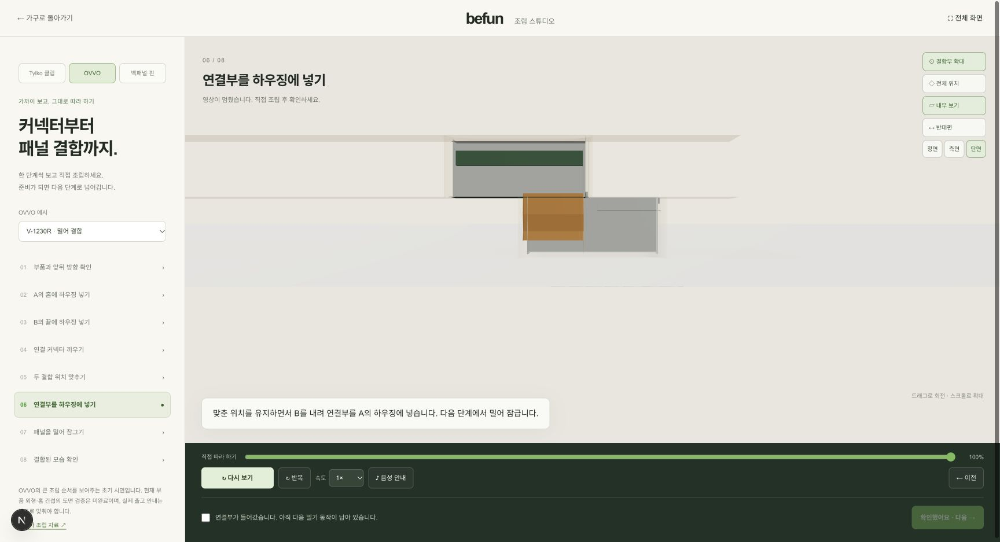
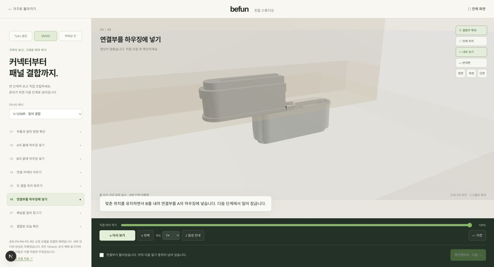

# R2.1-ASM — OVVO 예제 접합 교정 제출

실행 URL: http://localhost:3003/assembly-guide?topic=connector

기존 실행 경로의 임의 `Housing`/`Connector`를 제거하고 HW의 공개 PH/RH/PC/RC와 `guideMounts`를 연결했다. 끝캡의 캡슐 외곽 침범과 잘못된 PH 회전을 교정했다. 미확정 포켓 내부를 직선 목재 벽으로 그리지 않고 입구 외곽과 내부 생략 영역을 분리했다. 이 결과는 예제 접합 시연이며 공급사 CAD 동일성·완전한 메시 충돌 해결·제조 승인 결과는 아니다.

## 공식 도면 대조와 수정 전 재현

| 항목 | 공식 자료 | 기존 실행 | 교정 |
|---|---|---|---|
| P 부품·동작 | PH / PC / PH, 압입 | 박스 하우징과 임의 커넥터 | 공유 PH×2와 양방향 PC, 법선 압입만 |
| R 부품·동작 | PH / RC / RH, 진입 후 장축 슬라이드 | 대칭 박스와 임의 스프링 형상 | PH와 비대칭 RC, 립/창이 다른 RH |
| 15mm | R 설치도 4. Release의 슬라이드 해제 표기 | releaseTravel15를 조립에도 직접 사용 | 해제 표기는 별도 상수/함수. 조립 이동은 HW 예제 pose를 소비하며 inferred 표시 |
| PH 끝 방향 | HW의 S_A = X_Sπ | 장면 Xπ로 뒤집음 | Q·X_Sπ = 장면 Zπ로 뒤집음 |
| 홈 | 평면 외곽 30×9.4, 깊이12.5±0.5; 내부 언더컷 수치 없음 | 같은 캡슐을 전 깊이에 직선 압출 | 확인된 입구 외곽만 그리며 미확정 내부 깊이구간은 절개 예시로 생략 |
| 끝캡 | 캡슐 안에 들어가는 외곽 | 모서리(폭4.3, 장축14.2)의 반경 초과1.10517010948mm | 공유 둥근 외곽의 실제 장착 정점으로 재검사 |

원본: [P 설치도](https://ovvotech.com/wp-content/uploads/2022/09/V-1230P-Combined.pdf), [R 설치도](https://ovvotech.com/wp-content/uploads/2022/09/V-1230R-Releasable-Miling-Connector-Instructions.pdf), [R 사양서](https://ovvotech.com/wp-content/uploads/2022/06/OVVO-V-1230R.pdf). 저장된 PDF와 원본 페이지 렌더는 `docs/tylko-reference/sources/ovvo-audit-001-*`와 대응 screenshots에 있다. 대조 대상은 OVVO-AUDIT-001(외형), 002(미확정 내부 프로파일), 003(끝캡 간섭)이다.

UI의 A 받침판 = HW 계약의 판 B(고정 PH/RH), UI의 B 세로판 = 계약의 판 A(움직이는 PH+PC/RC). 공식 조립 방향과 공식 해제 순서는 구분했다. R 해제 sampler는 +장축 슬라이드 후 +법선 들어올림이며 P 해제를 거부한다. 해체 영상 UI는 제공하지 않는다.

## 실제 연결·변환

- 앱 import: `@/components/three/furniture-hardware/ovvo`의 `OvvoPH`, `OvvoRH`, `OvvoPC`, `OvvoRC`, `guideMounts`. HW 소스는 수정하지 않았다.
- 1장면 단위 = 1mm, 물체 scale=1. CNC 공통 `applyConnectors`가 계산한 두 접합점 ±105mm를 재사용한다.
- S의 장축X→장면+Z, 폭Y→+X, 법선Z→+Y. Q=(-0.5,-0.5,-0.5,0.5). 위쪽 PH만 Q·(1,0,0,0), 커넥터에는 위쪽 뒤집기를 적용하지 않는다.
- settled `guideMounts(P pressed/R locked, center)`의 위치·쿼터니언을 부품 자식에 적용하고, 움직이는 판 부모에 `(0,panelGap,panelSlide)`를 한 번 적용한다. R 삽입 종료=(0,0,center+15), 슬라이드 종료=(0,0,center). 이중 이동/0.1 스케일 없음.
- `jointPose`는 `sampleOvvoAssembly`를 호출한다. R 조립 이동값은 `guideMounts(R inserted)-guideMounts(R locked)`에서 얻고 `assemblyTravelStatus='inferred'`를 반환한다. 별도 독립 하드웨어 치수표를 만들지 않았다.
- geometry는 HW 부품이 소유·폐기, 주입 재질은 GuideScene이 소유·폐기. 장착 group은 `dispose={null}`. 정면/측면/절단은 같은 카메라 반경35와 FOV40을 사용한다. 절단에서 양면을 표시해 남은 뒷면을 관찰하며 실제 절단 캡 메시를 제조 단면으로 주장하지 않는다.
- 내부 보기와 절단에서 그림자를 줄이고, topic을 떠나면 전역 clipping/그림자 상태를 복원한다. 정상 모드의 그림자 bias도 근접 화면 줄무늬를 줄이도록 보정했다.

HW 담당은 `docs/team-tasks.md`의 **HW-03/HW-05 실제 연결 확인 완료**에서 이동 1회, Z축π 해석, PH/RH/PC/RC 방향 일치와 브라우저 P↔R6회 오류0을 확인했다. 증거는 `docs/handoffs/claude-2-hardware-assets/r2-ovvo/hw03-guide-*.png`이다.

## ASM-01~07 결과

| ID | 결과 | 증거와 한계 |
|---|---|---|
| ASM-01 | PASS | P7/R8 모든 단계의 0/0.5/1과 역방향 재호출 동일, 숫자 NaN 없음. 기존 단계 경계 연속성 검사 유지 |
| ASM-02 | PASS | P 모든 단계 장축 이동0. PC와 PH×2가 두 CNC 접합점에서 동일 provider 앵커를 소비. 위 PH 법선=-Y, 장축=+Z 확인 |
| ASM-03 | PASS, 조립 거리 미확정 | R 진입(-법선) 뒤 슬라이드(-장축), PH/RC/RH 역할 일치. RC 반대 방향은 립/창 검사에서 실패. 15mm 조립은 inferred이고 공식 해제 치수와 분리 |
| ASM-04 | PASS, 내부 프로파일 unknown | 같은 시점의 전후9쌍. 양쪽 장착 PH/RH 몸체와 PC/RC를 공식 캡슐 외곽에 투영: 관통 정점 외곽 초과0. R 삽입/슬라이드 중간/종료 포함. 표면 접촉 정점은 관통으로 취급하지 않는다. 언더컷·삼각형 전체 충돌·탄성 미검증 |
| ASM-05 | PASS | 실제 재생 중 P06→R01(8단계,0%)→P01(7단계,0%). 재생 정지/확인 해제, 모델·offset·자동 시점 초기화. `switch-P-R-P.png` |
| ASM-06 | PASS | 기존12개 모두 유지. Tylko 원본/추정3D 각각5단계, 백패널7단계 복귀 확인. 별도 topic. 다리 핀 해제를 재사용하지 않음. 회귀 캡처2개 |
| ASM-07 | PASS | 데스크톱1728×937, 모바일390×844. 초기 모바일 보기 도구의 너비288px 겹침을94px로 수정. document 가로폭/scrollWidth 모두390. 실제 회전·휠 확대·확대버튼 복귀·단계 가로 스크롤 확인. 실제 부품 정점의 카메라 투영 검사 포함 |

브라우저 재생/일시정지/반복/이전 이동, 내부/정면/측면/단면, 수동 회전 후 자동 시점 복귀를 확인했다. 진행 완료 후 확인·다음 단계 기능은 유지한다. 원본 Tylko 자료는 실제 조립 완료와 구분하고, 추정3D는 명시적으로 선택해야 보인다. 모바일에서 페이지 아래에 있는 확인 버튼은 정상 스크롤로 접근할 수 있다.

## 전후 캡처

모든 비교는 첫 접합점, 같은 단계/진행률/카메라를 사용한다. JPG는 실제 브라우저 CUA가 반환한 원본 JPEG 바이트이며 생성 이미지가 아니다. 인코딩을 확인해 확장자를 교정했고 픽셀은 변경하지 않았다. 수정 전 소스는 `before-*.txt`로 보존했고 실행 경로에는 없다. `manifest.json`에 source/JPEG SHA256과 단위·시점을 기록했다.

| 상태 | 수정 전 | 수정 후 |
|---|---|---|
| P02 정면100% | [before](before-P-front.jpg) | [after](after-P-front.jpg) |
| P02 측면100% | [before](before-P-side.jpg) | [after](after-P-side.jpg) |
| P02 단면100% | [before](before-P-section.jpg) | [after](after-P-section.jpg) |
| P06 압입 종료/내부/단면 | [before](before-P-pressed.jpg) | [after](after-P-pressed.jpg) |
| R02 정면100% | [before](before-R-front.jpg) | [after](after-R-front.jpg) |
| R02 측면100% | [before](before-R-side.jpg) | [after](after-R-side.jpg) |
| R02 단면100% | [before](before-R-section.jpg) | [after](after-R-section.jpg) |
| R06 진입 종료/내부/단면 | [before](before-R-inserted.jpg) | [after](after-R-inserted.jpg) |
| R07 슬라이드50%/내부/단면 | [before](before-R-slide-mid.jpg) | [after](after-R-slide-mid.jpg) |

추가: [R 잠금 종료](after-R-locked.jpg), [모바일 OVVO](mobile-390-main.jpg), [모바일 절단](mobile-390-section.jpg), [모바일 Tylko](mobile-390-Tylko.jpg), [수동 시점](manual-camera.jpg), [자동 복귀](camera-return.jpg).

수정 전 R 진입:

수정 후 R 진입:

## 검사 명령·제출 범위

`node --no-warnings --test src/lib/assembly-guide/*.test.mjs`: **24/24 통과**(기존12 + 동작/외곽7 + 실제 장착 통합5). 정점 검사 성공은 CAD/제조 검사 성공이 아니다.

`npm run lint`: **오류0, 기존 경고7**. 변경 범위 eslint는 오류/경고0. 격리 `/private/tmp/befun-assembly-check-jrhak3ly`의 `npm run build -- --webpack`는 전체 TypeScript와 프로덕션 빌드를 검사한다. 최초 검사에서 카메라 up tuple 타입 오류를 찾아 수정했다. 최종 빌드 및 전체 TypeScript **통과**. 모바일 CSS·그림자 후속 수정까지 포함한 최종 스냅샷을 검사했다. 공용 개발 서버와 `.next`는 수정/중단하지 않았다.

남은 미확정: 공급사 내부 단면/바브 수치·압입 탄성·실물 CAD, 정확한 R 조립 이동, 실제 주문 panel/joint 연동 및 전체 제품 순서, 다리 전용 안내, MP4 내보내기. 이번 차수는 **OVVO 예제 접합 시연 교정**만 제출한다.

최종 검증 기록: 변경 eslint 오류/경고0, 전체 lint 오류0/기존 경고7, 최종 격리 webpack build/전체 TypeScript 통과. 브라우저 error 로그0. 임시390px 및 CDP 크기 변경 복원, 교정 장면 탭 유지. 9쌍 실제 JPEG 크기1728×937 동일, 모바일2장390×844 확인. 이미지 확장자·SHA256·참조 경로 검증 완료.
