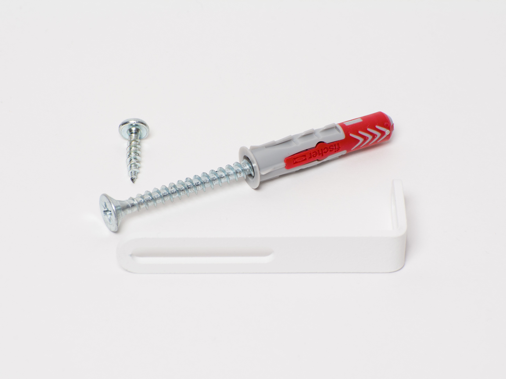

# Securing Your Tylko to the Wall

Source: https://tylko.elevio.help/en/articles/14-securing-your-tylko-to-the-wall | Saved: 2026-10-14

As a shelf or a wardrobe grows in height, so does its centre of gravity. To keep your Tylko safe, we include brackets so you can secure it to the wall.

We ship every Tylko with the perfect amount of bracket sets, calculated according to its size. 

In the assembly manual you'll find a diagram showing the suggested positioning of the wall attachments, but there are no pre-drilled holes in the shelf or the wardrobe. This way, if the suggested placement of the brackets doesn’t suit you (for example, if you have wiring in the wall or a light switch in the way), you can change it.

- 

The iron bracket *
*max. distance between the wall and the piece of furniture- 5cm

- 

The wood screw (for mounting the bracket to your Tylko)

- 

The universal wall screw (adaptable to every wall type)

### Was this article helpful?

