# Back panels and supports

Source: https://tylko.elevio.help/en/articles/32-back-panels-and-supports | Saved: 2026-10-14

Our click-in system is designed to make assembly quick and easy and should work perfectly. However, as the connecting elements are mounted by hand, from time to time our customers may notify us about difficulties they're experiencing while assembling their Tylko furniture. Luckily, 99% of these cases can be resolved with just a few minor tweaks, and you can easily fix the problem yourself, too. In this article, you'll learn about installing and removing back panels and support elements, as well as how to solve the most common issues with them.

1. The Elements
2. How do I install a back panel or support element?
3. My back panel or support element's drilled holes are incorrect.
4. How do I remove a back panel or support element? 

Elements

Back panels (the label will start with a W) and support elements (label starting with S) both have two types of pins:  
Fixed pins on the bottom edge
Spring pins on the top side

  

<!--td {border: 1px solid #cccccc;}br {mso-data-placement:same-cell;}--><!--td {border: 1px solid #cccccc;}br {mso-data-placement:same-cell;}--><!--td {border: 1px solid #cccccc;}br {mso-data-placement:same-cell;}--><!--td {border: 1px solid #cccccc;}br {mso-data-placement:same-cell;}-->

 

How to assemble it?

First, align the bottom side (fixed pins) into the holes, then press the top edge (with spring pins) into place to lock them into position with a click.

<!--td {border: 1px solid #cccccc;}br {mso-data-placement:same-cell;}--><!--td {border: 1px solid #cccccc;}br {mso-data-placement:same-cell;}--><!--td {border: 1px solid #cccccc;}br {mso-data-placement:same-cell;}--><!--td {border: 1px solid #cccccc;}br {mso-data-placement:same-cell;}--> 

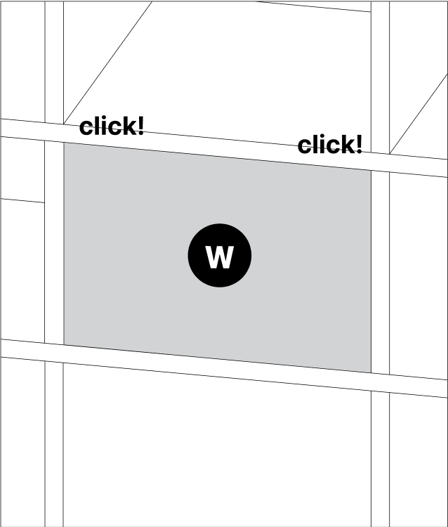

 

If you're having trouble installing back panels or support elements, here are some handy tips: If you're having difficulty installing a back panel, try inserting it at an angle and adjusting it once it is in the opening. Make sure both fixed pins on the bottom edge are aligned in the drilled holes on the adjoining horizontal element. You can also gently knock the the surrounding vertical elements to make more space for the back panel to insert.

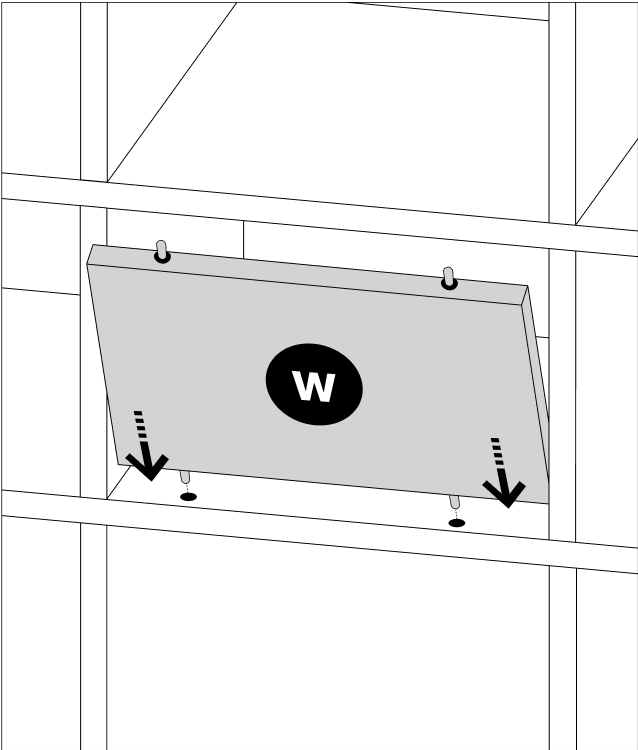

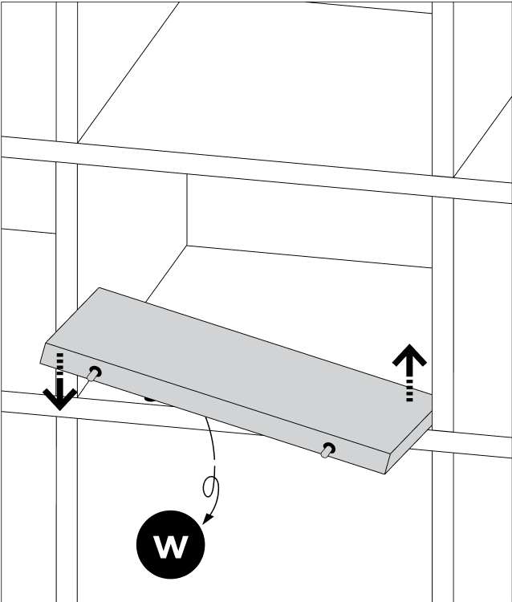

If you're having difficulty inserting the back panel heightwise, align the bottom edge pins in the hole, then use the felt-covered protective board and a rubber mallet to gently tap the back panel until it fits into the opening. Push the spring pins in and lock the panel into place with a click. The back panel should be flush with the unit on every side. 

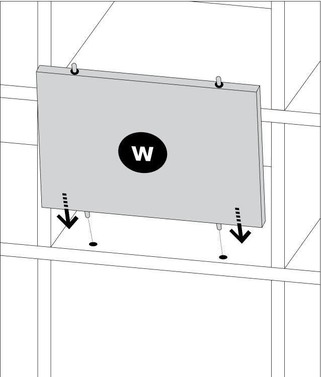

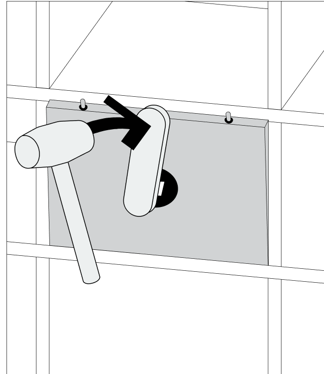

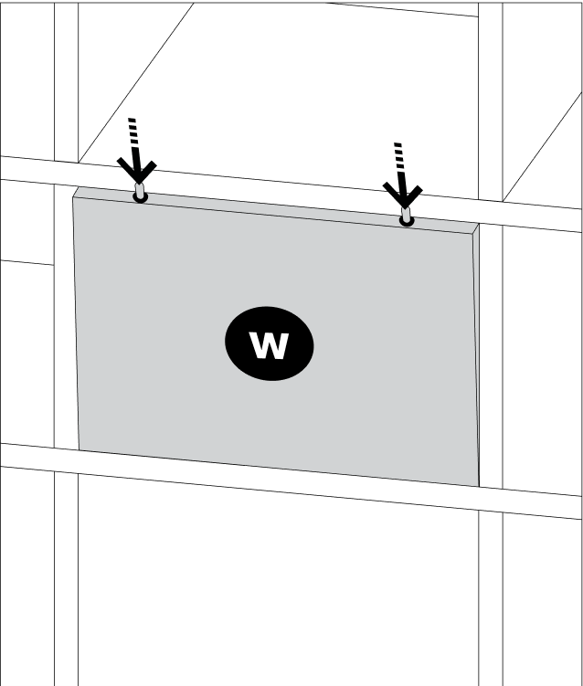

<!--td {border: 1px solid #cccccc;}br {mso-data-placement:same-cell;}--><!--td {border: 1px solid #cccccc;}br {mso-data-placement:same-cell;}-->

Check out this link for a quick video demonstrating this method:   

[Video: https://www.youtube.com/watch?v=blfcT3pgLCs](https://www.youtube.com/watch?v=blfcT3pgLCs)

<!--td {border: 1px solid #cccccc;}br {mso-data-placement:same-cell;}--><!--td {border: 1px solid #cccccc;}br {mso-data-placement:same-cell;}-->My back panel or support element was pre-drilled incorrectly.

<!--td {border: 1px solid #cccccc;}br {mso-data-placement:same-cell;}--><!--td {border: 1px solid #cccccc;}br {mso-data-placement:same-cell;}-->You might discover that the pins do not fit into the pre-drilled holes on your unit's horizontal elements.

To confirm this, first slide the back panel or support element left to right and see if the problem persists. If the pins still do not align, you'll need to check that the elements were manufactured correctly. 

To do this, measure the spacing on the back panel or support element from the centre of the pins to the edge on both sides. You'll also need to measure the spacing of the unit's horizontal element pre-drilled holes location in the same way.

If the problem is occuring in more than one component, you will need to measure each of them individually.  

 <!--td {border: 1px solid #cccccc;}br {mso-data-placement:same-cell;}--><!--td {border: 1px solid #cccccc;}br {mso-data-placement:same-cell;}-->Back Panel Measurements (4 total) 

<!--td {border: 1px solid #cccccc;}br {mso-data-placement:same-cell;}--><!--td {border: 1px solid #cccccc;}br {mso-data-placement:same-cell;}--> 

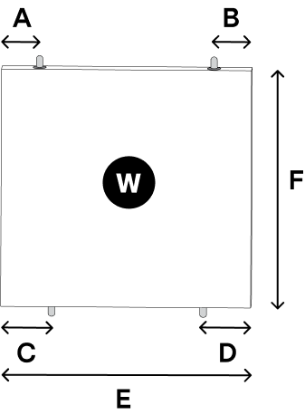

<!--td {border: 1px solid #cccccc;}br {mso-data-placement:same-cell;}--><!--td {border: 1px solid #cccccc;}br {mso-data-placement:same-cell;}-->Horizontal Unit Element Measurements (4 total)

How Do I Remove a Back Panel or Support Element? 

In order to remove back panels, you will need a rubber mallet and the protective felt-covered board. You'll also need tape, and ideally, a second person. To dismantle the back panels in a low unit, lift the furniture slightly and slide the felt-covered protective board under the first vertical element in the row.

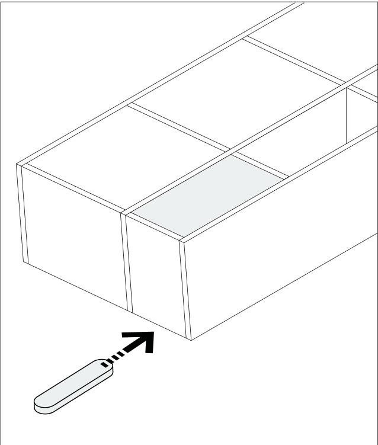

Secure the back panels with tape, keeping it secure, but not taut. This is to make sure that the panels do not fall out and become damaged or cause injury.  Tip: for larger back panels, use two or more pieces of tape as needed.

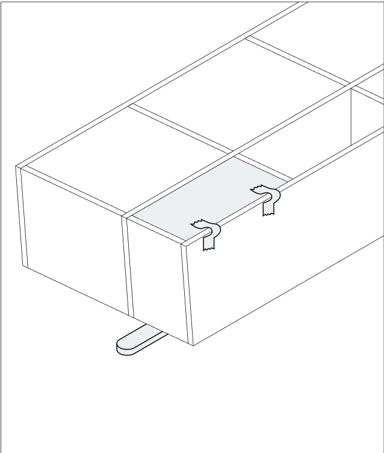

Then, gently tap the horizontal element below the back panel you wish to remove with the rubber mallet, using enough force to loosen it.

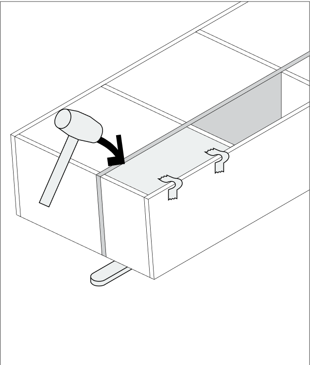

Once you've partially disconnected the first element, place the felt-covered protective board below the next-closest vertical element and tap the horizontal unit element gently with the rubber mallet.

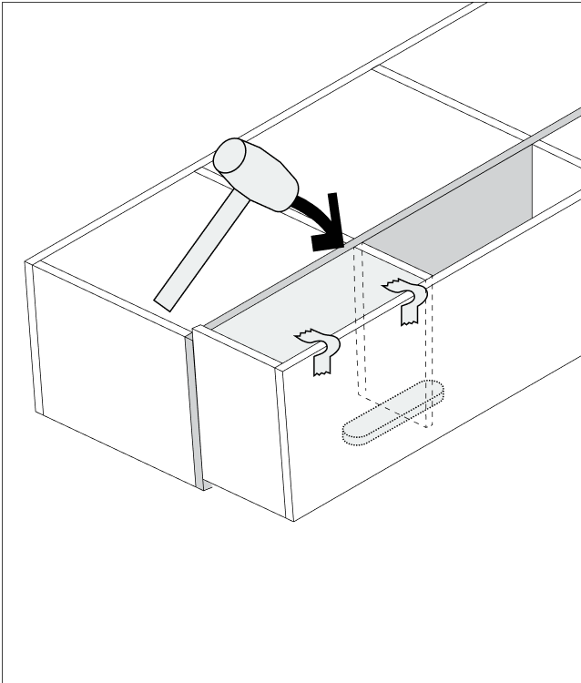

Once you've partially disconnected the next element, place the felt-covered protective board below the next-closest vertical element and tap the horizontal unit element gently with the rubber mallet.

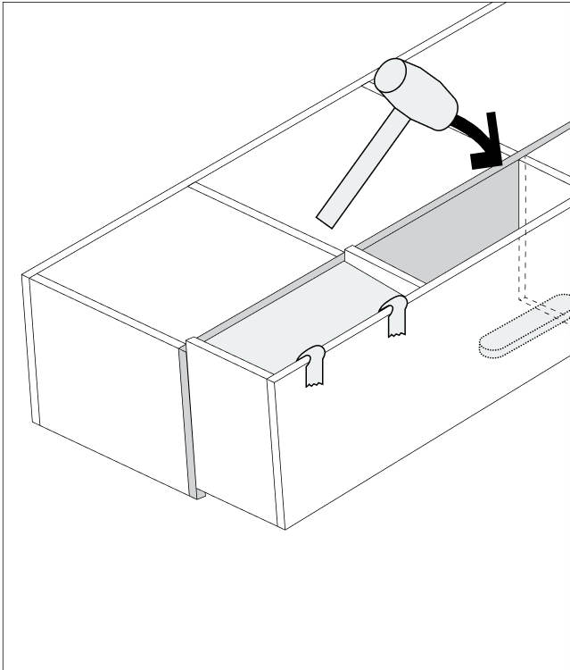

Continue removing alternating horizontal and vertical elements in the row until the back panels are freed from the spring pins. As these back panels are removable, they will fall into the center of your unit's compartments.  

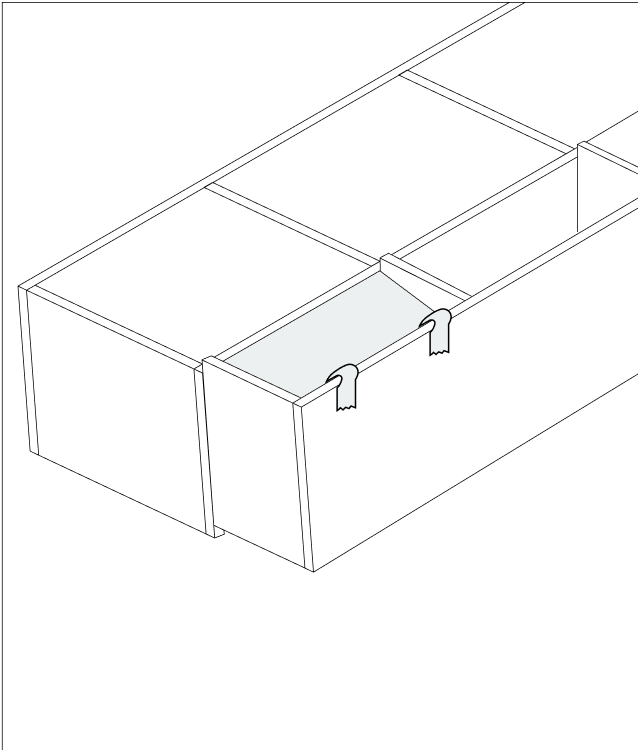

<!--td {border: 1px solid #cccccc;}br {mso-data-placement:same-cell;}--><!--td {border: 1px solid #cccccc;}br {mso-data-placement:same-cell;}-->An alternative method that works for well for low/smaller units is to knock the first horizontal element row loose. 

<!--td {border: 1px solid #cccccc;}br {mso-data-placement:same-cell;}--><!--td {border: 1px solid #cccccc;}br {mso-data-placement:same-cell;}-->Secure the back panels with tape, keeping it secure, but not taut. This is to make sure that the panels do not fall out and become damaged or cause injury.  Tip: for larger back panels, use two or more pieces of tape as needed. 

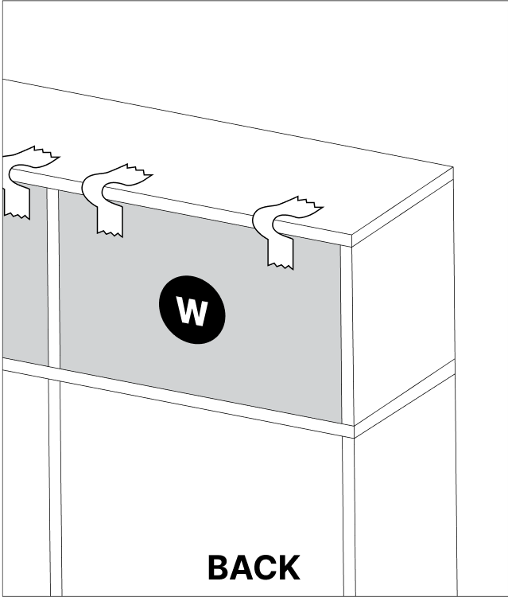

<!--td {border: 1px solid #cccccc;}br {mso-data-placement:same-cell;}--><!--td {border: 1px solid #cccccc;}br {mso-data-placement:same-cell;}-->Using a rubber mallet and the felt-covered protective board, gently tap the first row of horizontal elements lose, working from the front, while two adults support the unit on both sides. 

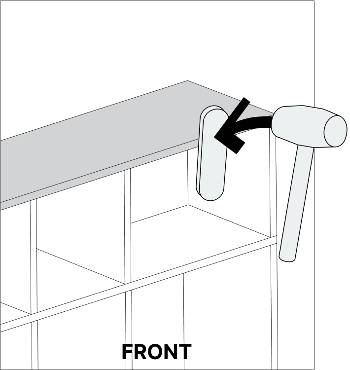

<!--td {border: 1px solid #cccccc;}br {mso-data-placement:same-cell;}--><!--td {border: 1px solid #cccccc;}br {mso-data-placement:same-cell;}-->Once the horizontal row has moved far enough back, the back panels will loosen and can be easily removed. 

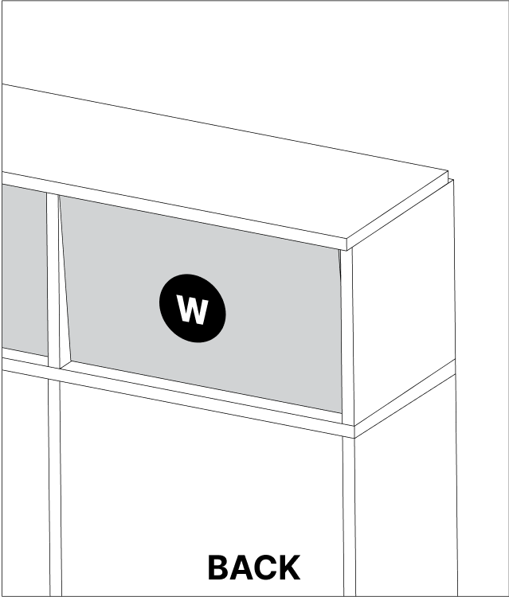

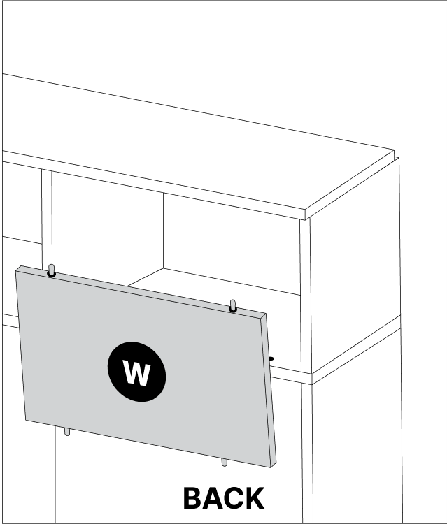

Looking for further guidance and help on how to disassemble your Tylko furniture?
You can find out [full disassembly manual](https://tylko.com/faq/articles/self-assembly-disassembly/how-do-i-disassemble-my-tylko) and handy [videos ](https://www.youtube.com/playlist?list=PLOAx97AcdPcbsI80lxKWiCT2SrMDD2ySn)here.

We hope this article helped resolve your issue. Should you need more advice or assistance, our customer service team and standing by to help. Reach out at hello@tylko.com.

<!--td {border: 1px solid #cccccc;}br {mso-data-placement:same-cell;}--><!--td {border: 1px solid #cccccc;}br {mso-data-placement:same-cell;}-->

### Was this article helpful?

