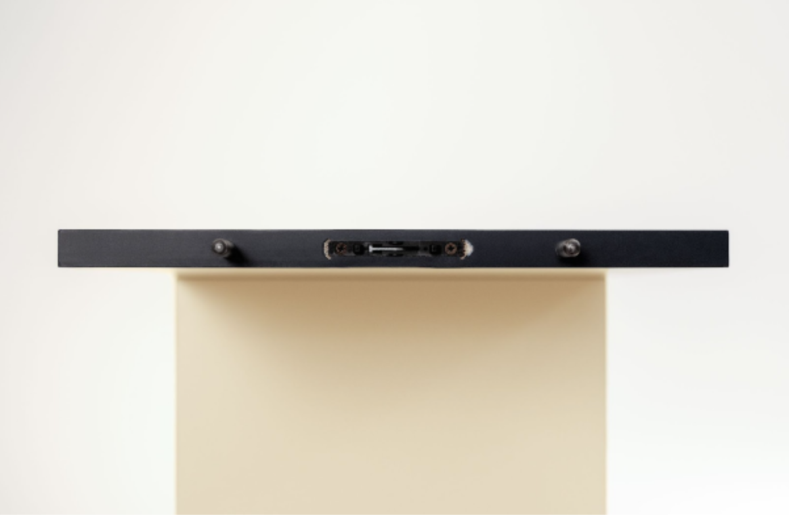
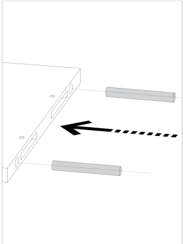
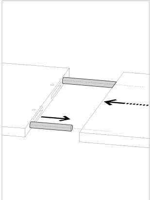
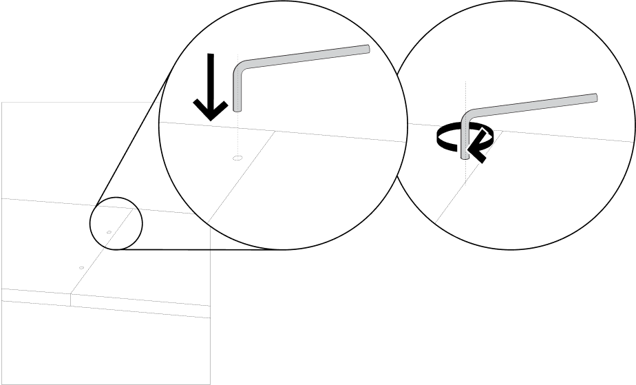
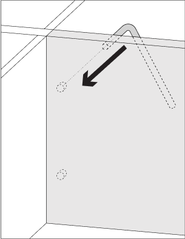
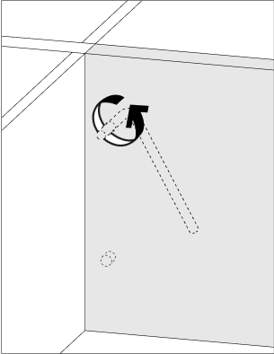
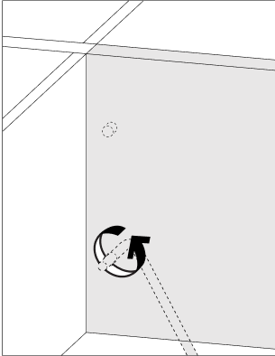

# Extra Wide Shelves: Connecting Two Halves

Source: https://tylko.elevio.help/en/articles/33-extra-wide-shelves-connecting-two-halves | Saved: 2026-10-14

We are able to produce shelves up to 240 cm long in one piece. Any unit designed to be longer than that – regardless of height – will come in two modules (easily constructed sections of your entire unit) and will be connected with a visible joint, also known as a Lamello connector. 

In this article, you'll learn more about assembly and disassembly by module, as well as a short description on how to solve the most common issues you may encounter.  

1. What is a visible joint (also known as a Lamello connector) ?
2. How do I assemble modules?
3. How do I disassemble modules?

What is an Visible Joint (aka Lamello)? 

Each module is joined by three fittings: a female connector, a male connector and a dowel. You can see them in the diagram below: 

<!--td {border: 1px solid #cccccc;}br {mso-data-placement:same-cell;}--><!--td {border: 1px solid #cccccc;}br {mso-data-placement:same-cell;}-->

If your fittings are different than the photos above – or missing – please send a photo to hello@tylko.com and describe the issue. We will get back to you with the appropriate solution.

How Do I Assemble Modules?

Before joining two modules, be sure that the horizontal and vertical elements are flush and aligned to prevent difficulty joining the two pieces. Should your Tylko need to be aligned, see the article about horizontals and verticals.

Checking to confirm that the fittings are in place, gently align the connectors of both modules and join by fitting the two modules together. Using the Allen wrench, tighten the joints together by inserting it into the drill hole in each of the horizontal elements and turning it. (Repeat on every horizontal element.) 

To make it easier to connect the two modules, you can pull the dowels out slightly, lay the two modules close together, then slide them into place. Alternatively, you can ask someone to help you, as joining two modules can be tricky.

How Do I Disassemble Modules?

First, detach the furniture from its wall mount. Insert a 4 mm Allen wrench (from the assembly of the furniture) into the drilled hole on the first horizontal element. Turn the wrench to loosen and disconnect the connectors. Repeat this action for each horizontal element.  

After unscrewing the connector joints with the Allen wrench, pull one of the two modules towards you so that the two joints disconnect. You may need to ask another person for help, as modules can be heavy and awkward.  

You can then proceed with the normal disassembly method.

[Video: https://www.youtube.com/watch?v=7fkFU6Tz4DA](https://www.youtube.com/watch?v=7fkFU6Tz4DA)

Note: In the video we demonstrate the method of assembling and disassembling modules while lying down, which works only for selected low furniture. For other types of furniture, we recommend assembling and disassembling modules with the units standing up, and with the assistance of three competent adults. 

We hope this article helped resolve your issue. Should you need more advice or assistance, our customer service team and standing by to help. Reach out at hello@tylko.com.

### Was this article helpful?

