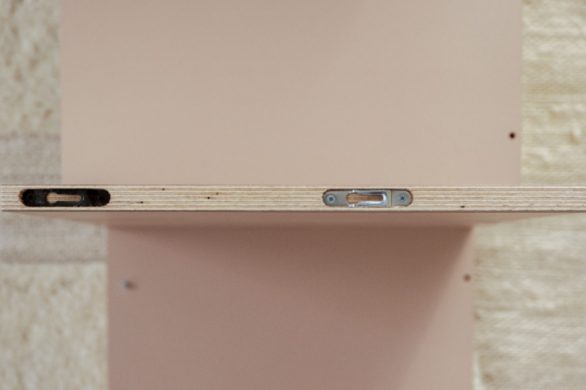
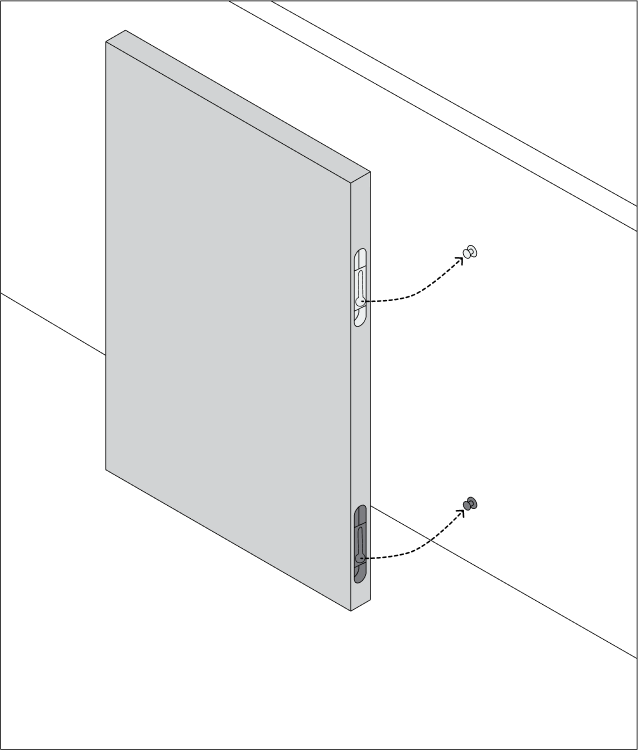
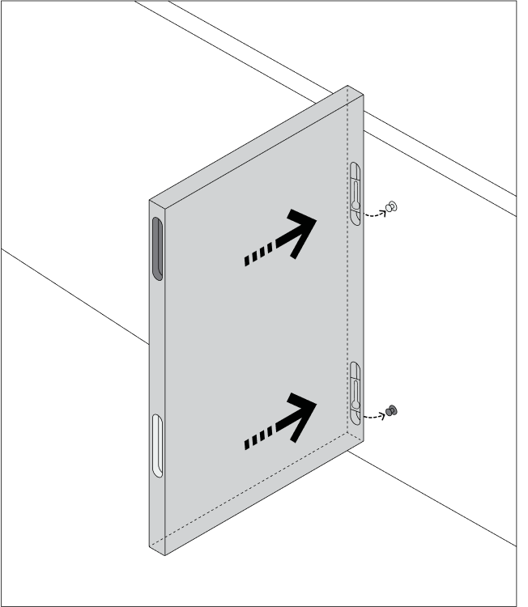
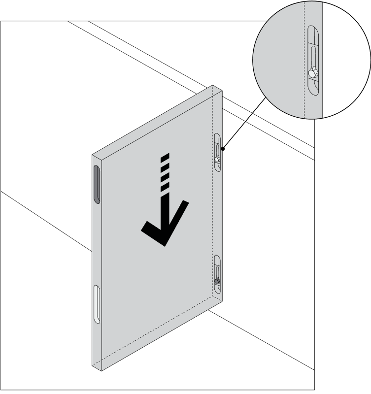
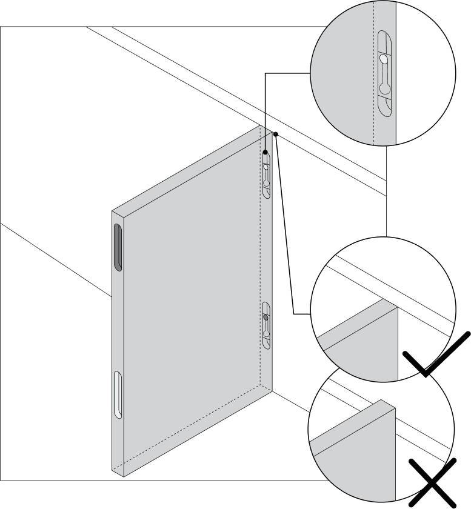
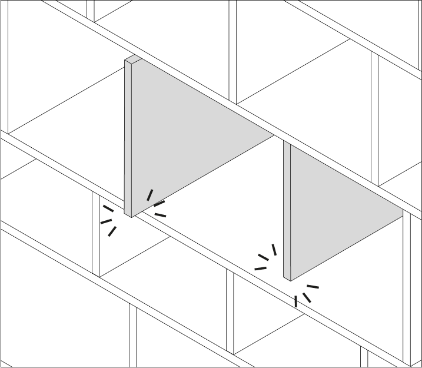
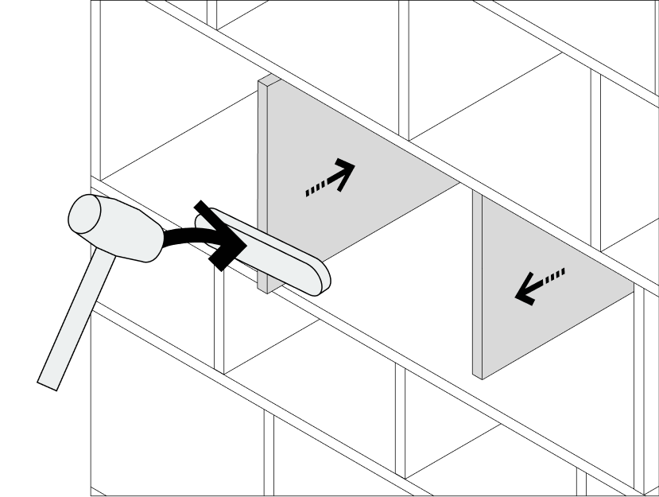
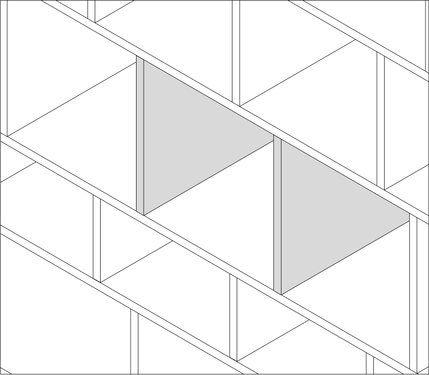

# Aligning Horizontal and Vertical Elements

Source: https://tylko.elevio.help/en/articles/34-aligning-horizontal-and-vertical-elements | Saved: 2026-10-14

With our colour-coded, click-together assembly system, you can save valuable time and energy.  In order to ensure stability during use, all components must be connected to each other in the proper manner, with stability ensured only if there is no loosening at the connections. In this article, you'll learn more about our click-in assembly system. 

1. What is a click-in system and how do I use it? 
2. How do I align the elements?

What is a Click-In System? How Do I Use It? 

Our click-in system consists of black and silver pins and black and silver connectors. This is how you will assemble every vertical and horizontal element. As our furniture is delivered flat packed, we developed this ingenious click-in system to simultaneously guarantee structural stability and make for a quick, easy and intuitive assembly.

<!--td {border: 1px solid #cccccc;}br {mso-data-placement:same-cell;}--><!--td {border: 1px solid #cccccc;}br {mso-data-placement:same-cell;}-->

When assembling your furniture, be sure to colour-match the pins and connectors: silver pins for silver connectors and black pins for black connectors.  You may notice some of your connectors are in black and orange – don't worry! This is just an older version of our colour coding. You'll want to match the colors in this situation just as you would the newer colours: orange pins align with orange connectors and black pins align with black connectors.  The click-in system consists of two types of connectors: a locking connector and a non-locking connector. The system is designed to lock the pin in place and prevent it from sliding out. Therefore, you may feel a little resistance when assembling the vertical and horizontal elements.

How Do I Align the Elements?

Each shelf is unique, and each element is produced separately. This is why some parts can be trickier to assemble than others. You may need a little more force to join some of the components together, but don't worry – included with your furniture you'll find a felt-covered board that will allow you to use a rubber mallet safely and align the pieces easily. 

Every vertical and horizontal element should be even and aligned with one another once you stand your unit. Before you fasten it to the wall, confirm that the elements have been assembled correctly and are perfectly square and aligned. 

Gently tap any elements that need to be aligned. Hit the front or back of the shelving unit as necessary, alternating between horizontal and vertical elements. 

Tip: Start with the bottom elements and align as you work up the unit. When hammering elements while the unit is standing, it is important to have a competent adult to help stabilise the furniture. 

In order to align the pieces, it may sometimes be necessary to hammer them element by element. This is where the felt-covered board comes in handy. You can knock vertical elements into position by placing the board vertically, and using the narrow edge. Please remember that when adjusting any elements, two competent adults must hold and stabilise the furniture as you work.

<!--td {border: 1px solid #cccccc;}br {mso-data-placement:same-cell;}--><!--td {border: 1px solid #cccccc;}br {mso-data-placement:same-cell;}-->

All horizontal and vertical elements should be aligned with one another. The elements should form an even, balanced grid. 

Need more guidance or help assembling your furniture? 
You can find out [full disassembly manual](https://tylko.com/faq/articles/self-assembly-disassembly/how-do-i-disassemble-my-tylko) and handy [videos ](https://www.youtube.com/playlist?list=PLOAx97AcdPcbsI80lxKWiCT2SrMDD2ySn)here.

We hope this article helped resolve your issue. Should you need more advice or assistance, our customer service team and standing by to help. Reach out at hello@tylko.com.  

### Was this article helpful?

