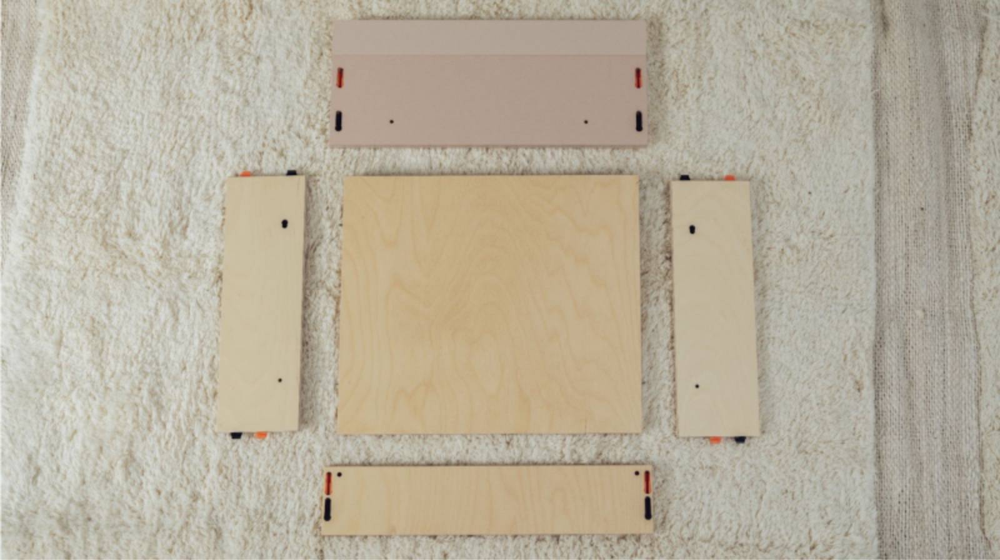
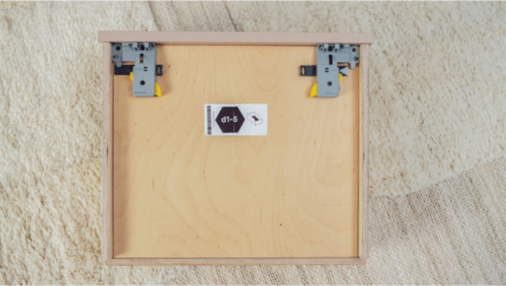
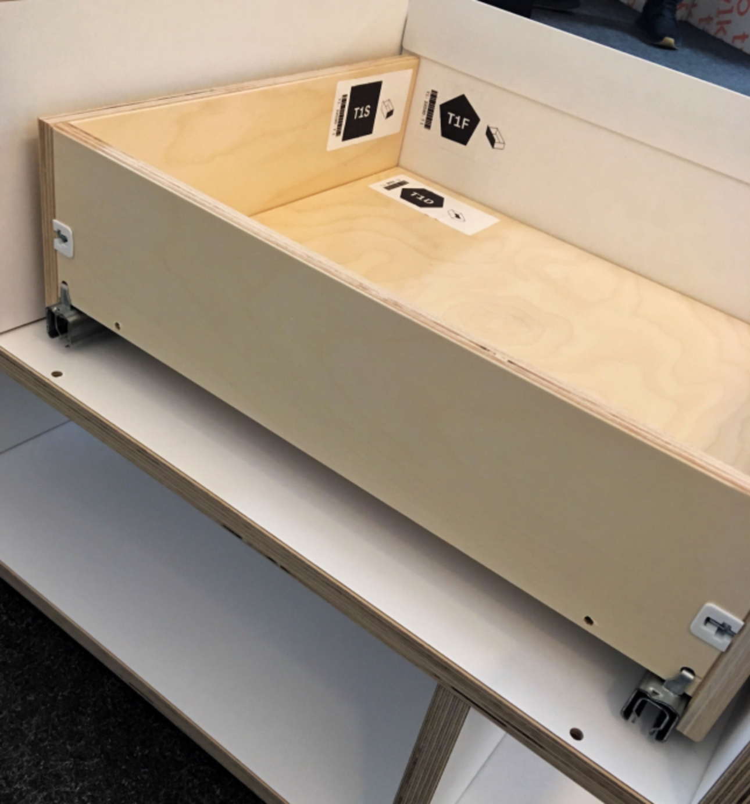
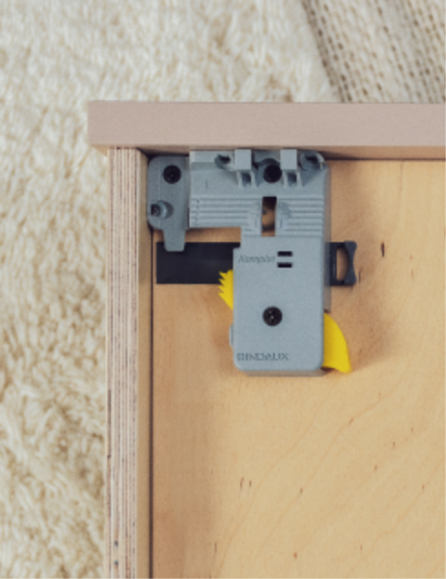
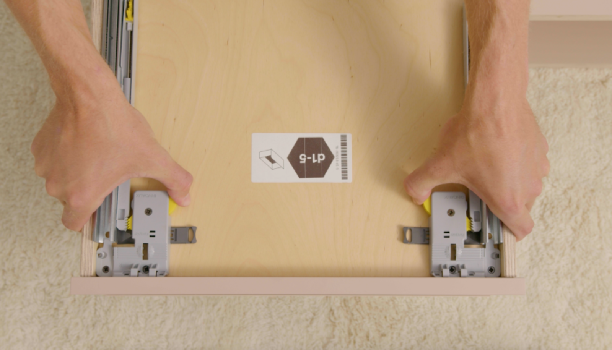

# Drawers: Assembly and Adjustment

Source: https://tylko.elevio.help/en/articles/36-drawers-assembly-and-adjustment | Saved: 2026-10-14

When designing our drawers, we paid special attention to the details for ease of assembly. Tylko drawers use fully extendable runners for deep access that are weighted to self-close, all with pre-mounted, click-in assembly elements.  

In this article, we introduce how to properly mount a drawer on rails,  the possible reasons for a malfunctioning drawer, and how to align drawers. In the final section, we address common problems that can sometimes occur.

How Do I Assemble a Drawer?  

To assemble the drawer, click together the front and sides of the drawer using the colour-coded connectors. Pay attention to the side element placement: to be properly assembled, the holes should face inward to allow the bottom of the drawer to connect. Next, click in the back of the drawer using the colour-coded connectors. Last, flip the connected elements over and connect the bottom of the drawer by aligning the pins, and clicking into place.

<!--td {border: 1px solid #cccccc;}br {mso-data-placement:same-cell;}--><!--td {border: 1px solid #cccccc;}br {mso-data-placement:same-cell;}-->

<!--td {border: 1px solid #cccccc;}br {mso-data-placement:same-cell;}--><!--td {border: 1px solid #cccccc;}br {mso-data-placement:same-cell;}-->

<!--td {border: 1px solid #cccccc;}br {mso-data-placement:same-cell;}--><!--td {border: 1px solid #cccccc;}br {mso-data-placement:same-cell;}--><!--td {border: 1px solid #cccccc;}br {mso-data-placement:same-cell;}--><!--td {border: 1px solid #cccccc;}br {mso-data-placement:same-cell;}-->

 

<!--td {border: 1px solid #cccccc;}br {mso-data-placement:same-cell;}--><!--td {border: 1px solid #cccccc;}br {mso-data-placement:same-cell;}--><!--td {border: 1px solid #cccccc;}br {mso-data-placement:same-cell;}--><!--td {border: 1px solid #cccccc;}br {mso-data-placement:same-cell;}--><!--td {border: 1px solid #cccccc;}br {mso-data-placement:same-cell;}--><!--td {border: 1px solid #cccccc;}br {mso-data-placement:same-cell;}-->

To mount the assembled drawer on the slide rails, simply place the drawer in the opening with the rails and push the drawer in slightly. You should hear the characteristic "click" sound to indicate the latch has connected. Open the drawer to confirm that it is properly assembled. If you have trouble sliding the drawer into place, try opening it a few times and then closing it with a little more force until the teeth from the latch on the bottom of the drawer connect with the teeth in the rails.  

<!--td {border: 1px solid #cccccc;}br {mso-data-placement:same-cell;}--><!--td {border: 1px solid #cccccc;}br {mso-data-placement:same-cell;}-->

 <!--td {border: 1px solid #cccccc;}br {mso-data-placement:same-cell;}--><!--td {border: 1px solid #cccccc;}br {mso-data-placement:same-cell;}-->

 

To see how to assemble a drawer, see this video:

[Video: https://www.youtube.com/watch?v=nQP5VWmSs3k](https://www.youtube.com/watch?v=nQP5VWmSs3k)

[Video: https://www.youtube.com/watch?v=hWDpACJiRWY](https://www.youtube.com/watch?v=hWDpACJiRWY)

Still having issues? Go the next section of the article.

How Do I Disassemble a Drawer?

Firstly, remove the drawer from the rails by pulling it off the slide rail catch. Once removed from the unit, remove the back of the drawer by simply pulling it up. You can then remove the bottom of the drawer by tilting the sides of the drawer slightly. Once the bottom is removed, you can then disassemble the sides of the drawer by pulling them up, as well.

To see how to disassemble a drawer, see this video:

[Video: https://www.youtube.com/watch?v=nQP5VWmSs3k](https://www.youtube.com/watch?v=nQP5VWmSs3k)

How Do I Adjust a Drawer? 

If a drawer rubs or catches, or is not sitting straight, it may need to be adjusted.

Locate the black levers on the bottom of the drawer, near the grey elements under the drawer. By pressing the levers or pulling them towards the inside of the drawer, the height of the drawer can be changed. To make the front of the drawer lower, push the gray element at the bottom out. To make it higher, push the element in.

<!--td {border: 1px solid #cccccc;}br {mso-data-placement:same-cell;}--><!--td {border: 1px solid #cccccc;}br {mso-data-placement:same-cell;}-->

A properly assembled drawer should not rub against the top or sides and is perfectly aligned with the shelf compartments. If it continues to drag, please check that the rail and drawer bottom are properly connected (the gray teeth on the slide rail should connect with the yellow teeth on the drawer bottom). If not, remove the drawer by pressing the yellow buttons on the bottom of the drawer at the same time. It will jump out automatically. Then slide the rails out completely, place it on the rails, and then close the drawer using a bit of force.  

<!--td {border: 1px solid #cccccc;}br {mso-data-placement:same-cell;}--><!--td {border: 1px solid #cccccc;}br {mso-data-placement:same-cell;}-->

 If that doesn't help, could there be something catching the rails? Is something making a noise when closing the drawer? What exactly do you notice? Please check that all drawer components are correctly assembled. In a correctly assembled drawer, the teeth from the slide rail and the drawer connector should be aligned. Look at the bottom of the drawer to confirm that the components are correctly connected.

If you have further difficulties, please contact us at hello@tylko.com and attach photos of your drawer. We'll need the following pictures:
A photo of the drawer from the top and bottom, so that we can see the mechanism on the bottom of the drawer
A photo of the mounted drawer slid into place
A photo of the drawer from bottom so that we can see how it is placed upon the slide rails

Once we have this information, we'll work to find the appropriate solution. 

If it seems like the drill holes on the front or back of the drawer are not in the same line as the pins on the bottom, we ask you to measure:
 
- The distance from the edge to the middle of the pin on both sides of the drawer bottom
- The distance from the edge to the middle of the drilling on both sides of the front or back of the drawer

We hope this article helped resolve your issue. Should you need more advice or assistance, our customer service team and standing by to help. Reach out at hello@tylko.com.

### Was this article helpful?

