# Incorrectly Assembled Elements

Source: https://tylko.elevio.help/en/articles/37-incorrectly-assembled-elements | Saved: 2026-10-14

Occasionally an element can be incorrectly assembled due to error or mislabelling. In the case of mislabelling, our apologies. Unfortunately this can sometimes occur and get missed during the final quality check. 

How Do I Remove and Reassemble an Incorrectly Placed Element?

The method for rotating an element depends on the connectors located on that element (for example if the element is plain, or contains a drawer rail or door hinges). It also depends at what stage of assembly the piece of furniture is in.

Remove and Reassemble: Drawer Rails

Place the furniture face down on the floor using a protective surface. Lift the unit and place the felt-covered protective board under the right bottom edge of the element you want to remove. Press firmly horizontally on both sides to remove the element. Flip the element so that the slide extends towards the front of the unit and so that the colour-coded pins and connectors align.

To see how to remove and reassemble an element with slide rails, see this video:

[Video: https://www.youtube.com/watch?v=tkMWk3KPwD8](https://www.youtube.com/watch?v=tkMWk3KPwD8)

Remove and Reassemble: Hinges 

Place the unit face down on the floor using a protective surface. Lift the unit and place the felt-covered protective board under the right bottom edge of the element you want to remove. Press firmly horizontally on both sides to remove the element. Flip the element so that the hinges face the front of the unit and the colour-coded pins and connectors align.

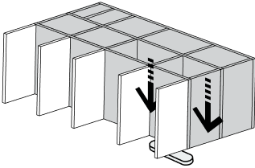

 To see how to remove and reassemble an element with hinges, see this video:

[Video: https://www.youtube.com/watch?v=71SSgWoilwE](https://www.youtube.com/watch?v=71SSgWoilwE)

Remove and Reassemble: Back Panels

To remove the back panels, lift the furniture slightly and slide the felt-covered protective board under the first vertical element in the row.

<!--td {border: 1px solid #cccccc;}br {mso-data-placement:same-cell;}--><!--td {border: 1px solid #cccccc;}br {mso-data-placement:same-cell;}-->

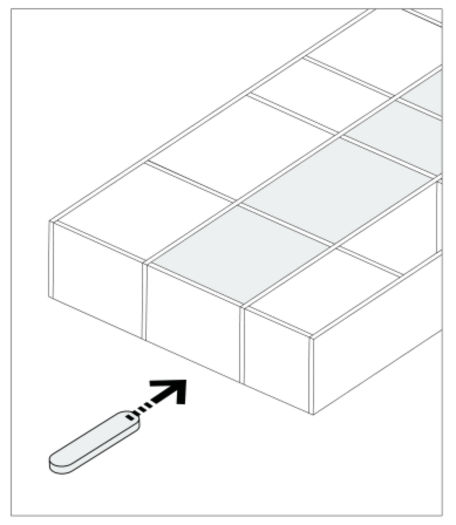

Secure the back panels with the tape. The tape should be secure but not tight. This will ensure that the components don't fall out and become damaged or cause injury. Tip: For larger back panels, secure the piece with two or three pieces of tape as needed. 

<!--td {border: 1px solid #cccccc;}br {mso-data-placement:same-cell;}--><!--td {border: 1px solid #cccccc;}br {mso-data-placement:same-cell;}-->

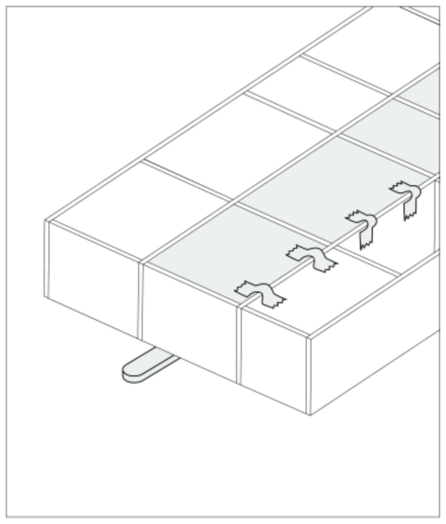

To disassemble, using a rubber mallet gently tap the horizontal element below the back panel you wish to remove, using enough force to loosen it. 

<!--td {border: 1px solid #cccccc;}br {mso-data-placement:same-cell;}--><!--td {border: 1px solid #cccccc;}br {mso-data-placement:same-cell;}-->

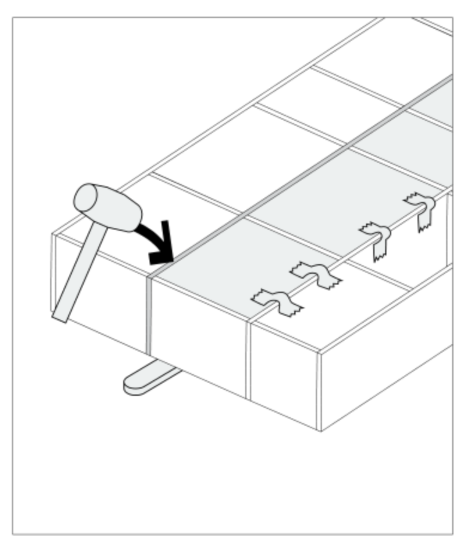

Once you've partially disconnected the first element, place the felt-covered protective board below the next-closest vertical element and tap the horizontal unit element gently with the rubber mallet.

<!--td {border: 1px solid #cccccc;}br {mso-data-placement:same-cell;}--><!--td {border: 1px solid #cccccc;}br {mso-data-placement:same-cell;}-->

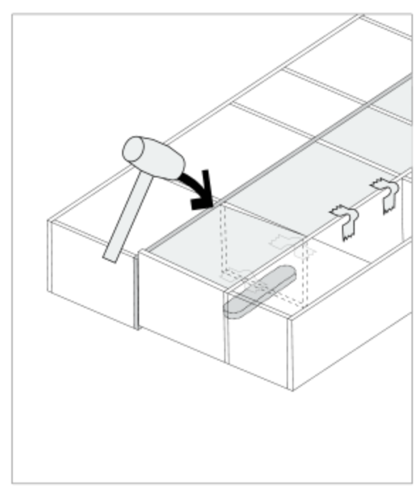

Once you have partially disconnected this element, place the felt-covered protective board under the next vertical element and gently hit the next horizontal element with the rubber mallet. This action must be repeated for every element in the row. 

<!--td {border: 1px solid #cccccc;}br {mso-data-placement:same-cell;}--><!--td {border: 1px solid #cccccc;}br {mso-data-placement:same-cell;}-->

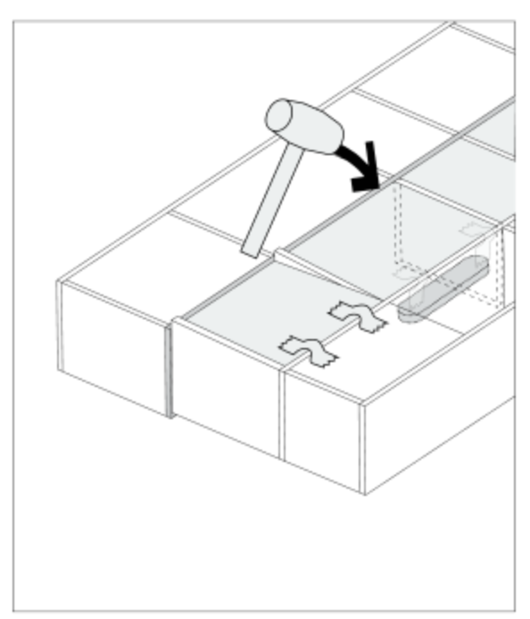

Repeat by removing all horizontal and vertical elements in the row until the back panel is freed from the pins. As they are removable, they will fall into the centre of the rack. 

<!--td {border: 1px solid #cccccc;}br {mso-data-placement:same-cell;}--><!--td {border: 1px solid #cccccc;}br {mso-data-placement:same-cell;}-->

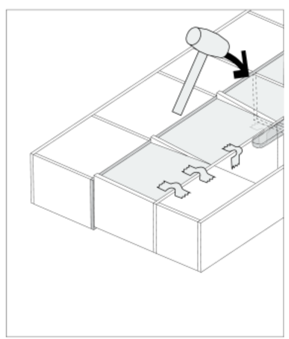

Now you can easily dismantle the verticals. Lift the furniture slightly and slide the felt-covered protective board under the horizontal element close to the vertical that you want to dismantle. Then press the horizontal element.  

<!--td {border: 1px solid #cccccc;}br {mso-data-placement:same-cell;}--><!--td {border: 1px solid #cccccc;}br {mso-data-placement:same-cell;}-->Flip the element so that the colour-coded pins and connectors align and click into place to reassemble. 

<!--td {border: 1px solid #cccccc;}br {mso-data-placement:same-cell;}--><!--td {border: 1px solid #cccccc;}br {mso-data-placement:same-cell;}-->

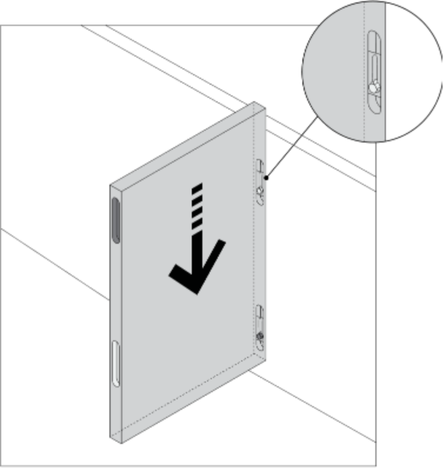

Once the element is mounted correctly, mount the removed section of furniture by aligning it and placing it gently over the verticals. Lift the section you wish to reassemble. One person should position the verticals of the section at the same time so that the verticals align properly with the connectors. 

Once the verticals and the section to be assembled have been correctly placed, connect the components. Gently tap the lower horizontals of the reassembled section with the rubber mallet.

<!--td {border: 1px solid #cccccc;}br {mso-data-placement:same-cell;}--><!--td {border: 1px solid #cccccc;}br {mso-data-placement:same-cell;}--> <!--td {border: 1px solid #cccccc;}br {mso-data-placement:same-cell;}--><!--td {border: 1px solid #cccccc;}br {mso-data-placement:same-cell;}-->

 

An alternative method that works especially well for lower units is to knock out the first horizontal element. 

Secure the back panels with the tape that is secure, but not tight. This will ensure that the panels don't fall out and become damaged or cause injury. Tip: For larger back panels, secure the piece with two or three pieces of tape as needed.

<!--td {border: 1px solid #cccccc;}br {mso-data-placement:same-cell;}--><!--td {border: 1px solid #cccccc;}br {mso-data-placement:same-cell;}-->

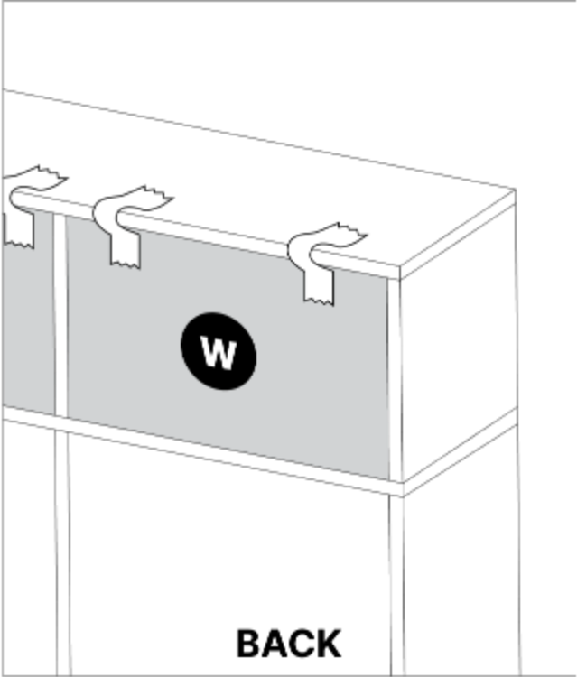

Using a rubber mallet and the felt-covered protective board, gently hammer the first horizontal elements from the front while two helpers hold the unit steady on both sides.

<!--td {border: 1px solid #cccccc;}br {mso-data-placement:same-cell;}--><!--td {border: 1px solid #cccccc;}br {mso-data-placement:same-cell;}-->

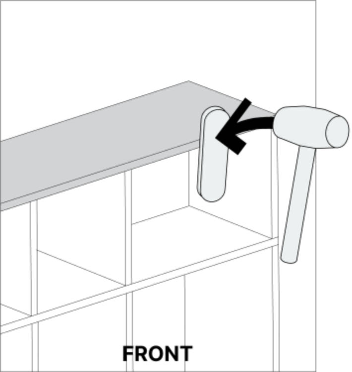

  

Once the horizontal element has moved and the back panels have loosened, they can be removed. 

<!--td {border: 1px solid #cccccc;}br {mso-data-placement:same-cell;}--><!--td {border: 1px solid #cccccc;}br {mso-data-placement:same-cell;}-->

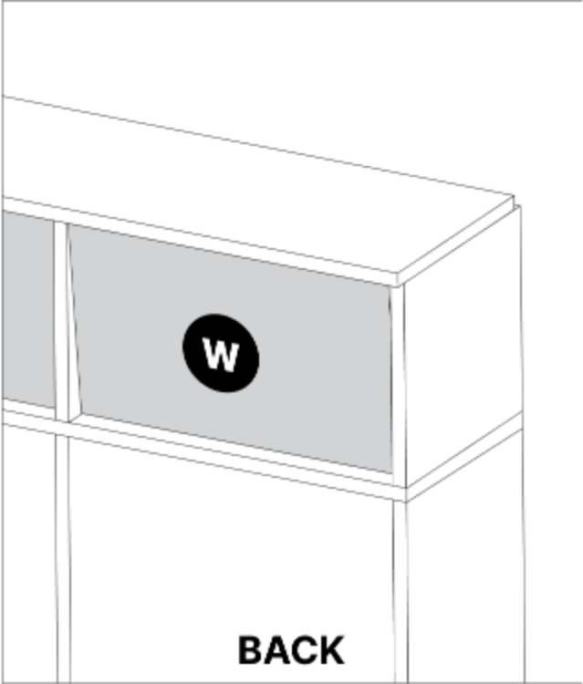

<!--td {border: 1px solid #cccccc;}br {mso-data-placement:same-cell;}--><!--td {border: 1px solid #cccccc;}br {mso-data-placement:same-cell;}-->

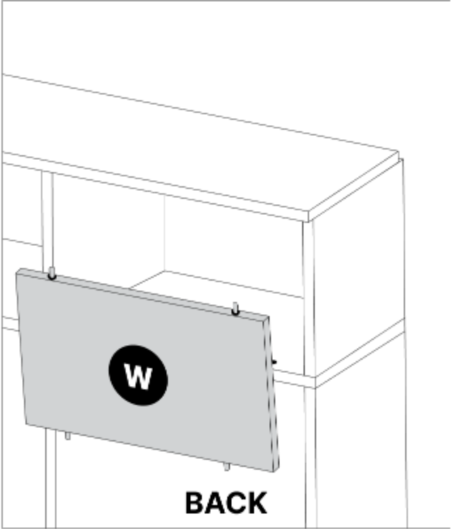

Then fully hammer out the horizontal element using the felt-covered protective board and the rubber mallet.

Next, place the unit face down on the floor using a protective surface. Lift the unit and place the felt-covered protective board under the right bottom edge of the element you want to remove. Press firmly horizontally on both sides to remove the element. Flip the element so that the colour-coded pins and connectors align. 

 <!--td {border: 1px solid #cccccc;}br {mso-data-placement:same-cell;}--><!--td {border: 1px solid #cccccc;}br {mso-data-placement:same-cell;}-->

<!--td {border: 1px solid #cccccc;}br {mso-data-placement:same-cell;}--><!--td {border: 1px solid #cccccc;}br {mso-data-placement:same-cell;}-->

Once the element is mounted correctly, reassemble the removed section of the unit by aligning it and placing it gently over the verticals. Lift the section you wish to reassemble. One person should position the verticals and the section at the same time so that the verticals align properly with the connectors. 

Once the verticals and the section to be reassembled have been correctly placed, connect the components. Gently tap the lower horizontals of the reassembled section with the rubber mallet.

<!--td {border: 1px solid #cccccc;}br {mso-data-placement:same-cell;}--><!--td {border: 1px solid #cccccc;}br {mso-data-placement:same-cell;}-->

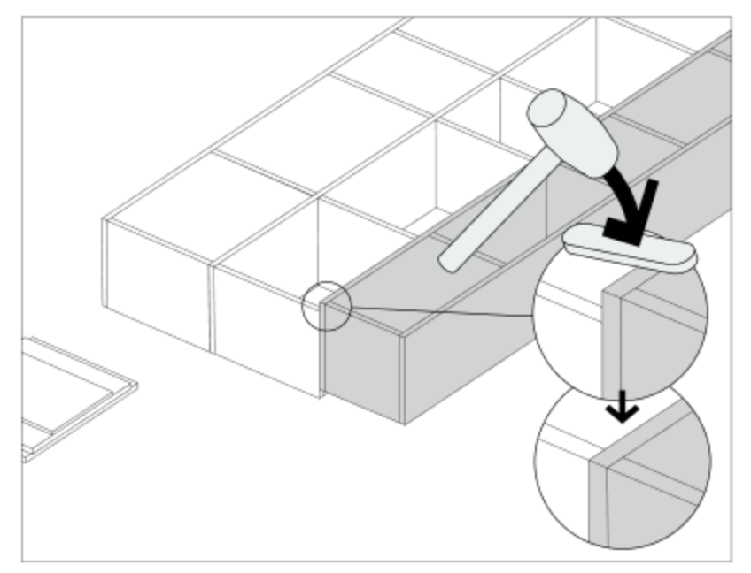

We hope this article helped resolve your issue. Should you need more advice or assistance, our customer service team and standing by to help. Reach out at hello@tylko.com.

### Was this article helpful?

