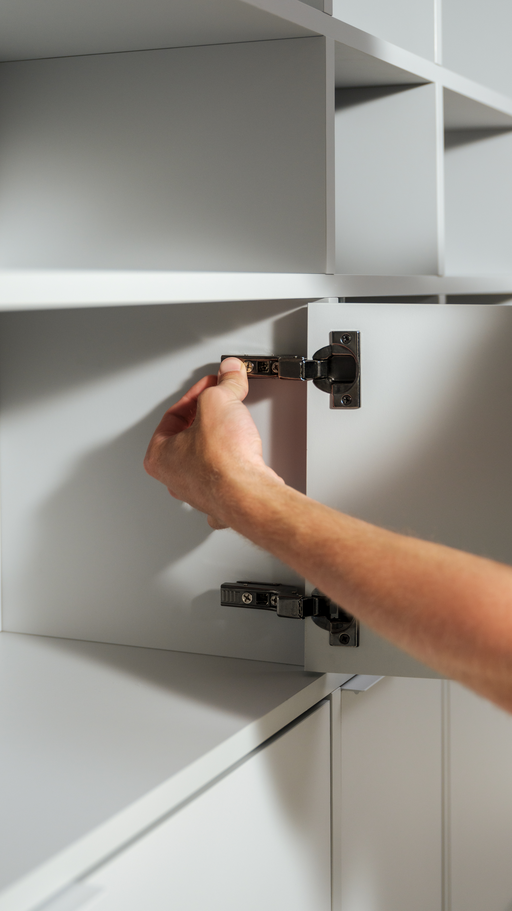
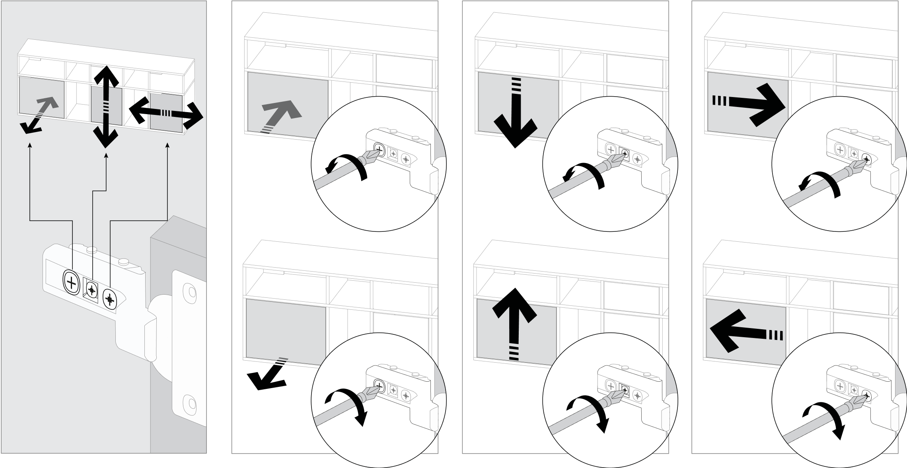
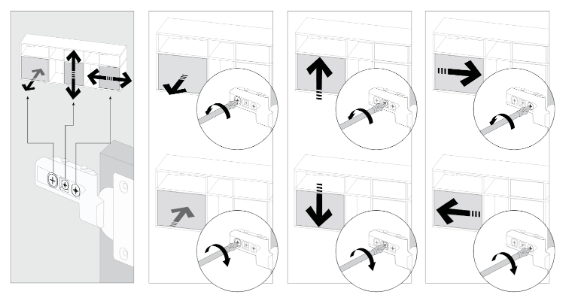
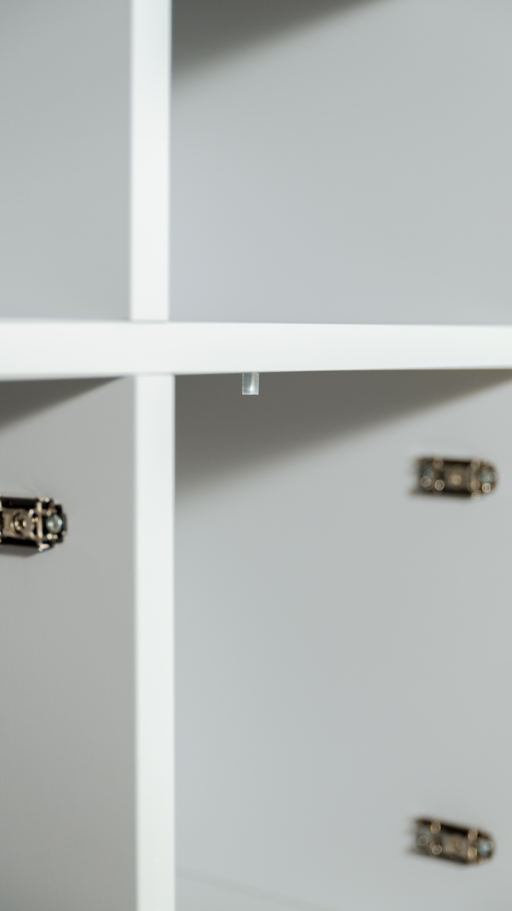

# Doors: Assembly and Adjustment

Source: https://tylko.elevio.help/en/articles/38-doors-assembly-and-adjustment | Saved: 2026-10-14

Tylko furniture comes with every connector attached, so you don't have to worry about screwing hinges on. In this article, we'll explain how to assemble doors, how to adjust and regulate them, and how the soft-close system works. In the final section, we'll address some common door issues that can occur and how to resolve them.  

How Do I Assemble a Door?

Every door comes pre-fitted with a hinge that attaches to the corresponding hinge connector located on the vertical element.

To assemble a door, simply lift it into place, align it with the hinge connectors, and press firmly to click it into place. You will hear a "click" sound when the door is properly attached.  

<!--td {border: 1px solid #cccccc;}br {mso-data-placement:same-cell;}--><!--td {border: 1px solid #cccccc;}br {mso-data-placement:same-cell;}-->

How Do I Adjust a Door?

Occasionally once a door is installed, it may need some slight adjustments to straighten it. In order to do so, you'll need to adjust the screws on the hinge connectors.

To adjust a door's height, use the central adjustment screw, while keeping the door attached.  

If a door is not parallel after installation, adjust its position using the adjustment screw closest to the unit's edge, while keeping the door attached.  

To adjust the depth of the door, adjust using the adjustment screw furthest from the edge, while keeping the door attached.  

Blum hinges

<!--td {border: 1px solid #cccccc;}br {mso-data-placement:same-cell;}--><!--td {border: 1px solid #cccccc;}br {mso-data-placement:same-cell;}-->

Tylko/Hafele hinges

If the door travels past the unit's edge, be sure the door bumpers are properly mounted.

If you're still having difficulties with the adjustment and alignment of your doors, please send us the measurements of the hinge placement on the door as well as on the vertical element, and the corresponding photos of each to hello@tylko.com. Once we have this information, we'll work to find the appropriate solution. 

My Door Doesn't Seem to Fit the Opening

Our apologies for the inconvenience. Sometimes problems can arise when assembling the door front. We kindly ask you to check following points:
- Check if the hinge connectors are in the right position (positioned as shown in the manual)
- Check if the hinges on the door have been placed on the furniture face side (if necessary, simulate turning around the element to see if it fits)
- Check if the hinge connectors are fixed correctly towards the front of the furniture
- Check if the distance between the hinge connectors is equal to the distance between the hinges
- If the door is slightly too big or too small, and there are similar sized doors for your unit, try swapping them. You can also gently tap the vertical walls using the felt-covered board, which may move the elements enough to provide room for the door.  

If your door issues persist, please send the length and height of the door, as well as the measurements of the spacing of the hinges and hinge connectors from the top and bottom of the door and vertical element as shown, and send them to us at hello@tylko.com. Once we have this information, we'll work to find the appropriate solution. 

We hope this article helped resolve your issue. Should you need more advice or assistance, our customer service team and standing by to help. Reach out at hello@tylko.com.

### Was this article helpful?

