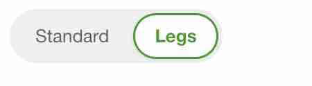
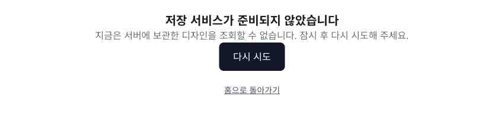

# R3-SAVE / R2.1-SAVE 검증

## R3 기존 선반 저장·baseType 복구

```sh
node --test scripts/storefront-save-validation/r3-save.test.mjs src/components/storefront/savedDesign.test.ts
```

R3 검사18개와 parser26개, 총44개입니다. 실제 Zustand stores와 configuration/parser/sharing 함수를 사용하며 DB/session/API를 mock하지 않습니다. Node의 localStorage/window 최소 test double은 로컬 목록/URL 저장 검사에서만 사용합니다. 실제 SQL·브라우저 DOM 검사와 구분합니다. 공유 click handler 검사는 실제 page.tsx의 해당 함수만 추출해 실제 store로 실행합니다.

Standard/Legs, Silver/Black, Pattern/Mosaic·개별 행·문/서랍·뒷판·재질, legacy/new URL, 구버전 기본값, 잘못된 enum,24cm/Pixel 보정, 새로고침을 흉내 낸 store 초기화→복구→재저장, 비활성12행 DTO 회귀를 검사합니다. 최신 사용자 “클래식도”에 따라 Classic/Natural도 Legs를 지원하며 재질 변경만으로 해제하지 않습니다. 원본/Tylko·제조 치수 동치를 검증하는 도구는 아닙니다.

- [R3 소스·build fingerprint와 검증 결과](r3-verification.json)
- [이전 공유 handler의 4행→1행 소실 재현 및 수정 결과](r3-regression.json)
- [브라우저 사례·mock 구분](r3-browser-cases.json)
- [SAVE-CONSUMER-PATCH](r3-consumer.patch): 읽기 전용 configurator 소비자용. 공유 workspace 소스에는 적용하지 않았습니다. 패널 마운트 해제 뒤 리더가 적용합니다. `patch --dry-run -p1 -i scripts/storefront-save-validation/r3-consumer.patch`로 적용 가능성을 확인했습니다. 신규 URL decode가 검증된 SavedDesign config 타입을 반환해 실제 restore 함수와 연결됩니다. 분리된 preview에서 tsc 통과.

READY 함수: `currentConfiguration`, `restoreSavedConfiguration`(유효 config이면 true, 무효이면 store 변경 없이 false), `parseSavedDesign`, `saveLocalDesign`, `serializeDesignConfig`, `deserializeDesignConfig`, `encodeDesignToURL`, `decodeDesignFromURL`. `/design-preview`·`/saved-designs`·`/share/[code]`는 실제 연결. `/configurator?state=...`의 운영 소비는 제출한 patch 적용 대기이며 URL 유틸 통과를 운영 적용 완료로 표시하지 않습니다.



아래 R2.1 검증 방법과 증거는 보존하며 R3 결과로 재실행했다고 주장하지 않습니다.

## 독립 API/DB 경계 검사

```sh
node --test scripts/storefront-save-validation/save.test.mjs
node scripts/storefront-save-validation/import-smoke.mjs
```

Node24 및 저장소에 설치된 TypeScript를 사용합니다. 실제 db.ts와 두 route를 로드하며 PrismaPg는 설치된 구현을 상속합니다. Prisma client 쿼리와 session만 test double로 대체합니다. import 안전성, adapter 설정 객체, 미설정503, 입력400/목록401/조회404, 기존 성공 응답과 소유권 필터, JSON 보존, 메서드 receiver, 비밀값을 제외한 오류 로그를 검사합니다. 실제 DB 저장 성공을 증명하는 검사는 아닙니다. 테스트의 합성 DATABASE_URL은 해당 Node 프로세스에서만 사용하고 원복하며 env 파일은 변경하지 않습니다.

import-smoke는 별도 Node 프로세스에서 실제 generated Prisma client와 설치 adapter/auth adapter를 사용하여 DB 미설정 import와 접근 guard를 확인합니다. client/query를 mock하지 않으며 DB 연결/SQL은 호출하지 않습니다. TypeScript/별칭/확장자 해석만 검사 loader가 처리합니다.

오류 code는 assignments/03-storefront.md 기준입니다: 400 `INVALID_DESIGN`, 401 `AUTH_REQUIRED`, 503 `DESIGN_STORAGE_UNAVAILABLE`, 500 `DESIGN_STORAGE_FAILED`, 404 `DESIGN_NOT_FOUND`. 기존 정상200 응답은 유지합니다.

## 실행 중인 서버 — DB 미설정

```sh
node scripts/storefront-save-validation/live.mjs http://localhost:3003 --unconfigured
```

먼저 공유 조회503을 확인하고 POST를 검사합니다. 올바르지 않은 입력400, 익명 목록/주문401, 인증 session/로그인/컨피규레이터의 import 안전성200, 유효 설계의 서비스 미준비503을 확인합니다. 설정된 서버를 미설정 모드로 잘못 검사하면 POST 이전에 중단합니다.

## 실제 DB가 이미 설정된 테스트 서버

```sh
node scripts/storefront-save-validation/live.mjs http://localhost:3003 --round-trip
```

새 테스트 선반 구성을 저장하고 반환 shareCode로 조회하여 원본 JSON과 비교합니다. 이 모드는 테스트 설계1개를 DB에 남깁니다. 실제 DB 또는 env/권한/테이블을 구성·변경하지 않으며 주문·결제·migration·데이터 삭제를 실행하지 않습니다. DATABASE_URL이 없는 경우 실제 왕복은 blocked이며 test double 검사 성공과 구분합니다.

## 브라우저 검증의 근거

실행한 사례와 네트워크 mock 여부는 [브라우저 사례](browser-cases.json) 및 [본인 handoff](../../docs/handoffs/codex-storefront-integration.md)에 기록합니다. Chrome/CDP mock은 해당 테스트 탭의 design API fetch만 대상으로 하며 Document/다른 API/실제 DB는 대체하지 않습니다. 실제503 화면에서 재시도 모의200은 실제 DB 저장/조회 성공이 아닙니다. 검증 후 interception patterns를 비웠습니다.


